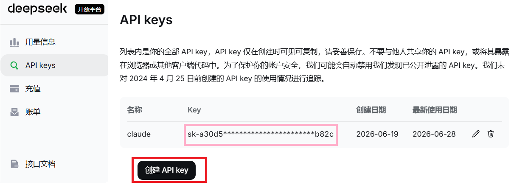

```{r setup, include=FALSE}
knitr::opts_chunk$set(out.width = "90%", fig.align = "center")
```


\newpage

# 将默认终端设置为`命令提示符`

在 Windows 中，终端可能默认打开 PowerShell。为了让初学者操作更统一，本课程建议先将默认配置文件设置为 `命令提示符`。

操作步骤如下：

- 在文件夹空白处点击鼠标右键；
- 选择 `在终端中打开`；
- 点击终端窗口顶部的下拉箭头；
- 选择 `设置`；
- 进入 `启动`；
- 找到 `默认配置文件`；
- 选择 `命令提示符`；
- 保存设置。

设置完成后，下次右键选择`在终端中打开`时，默认就会进入`命令提示符`环境。


\newpage

# 获取 Deepseek 的 API keys

- 点击 [https://platform.deepseek.com](https://platform.deepseek.com)，注册账号
- 充值 10 块钱即可
- 创建新的 API keys，随便取个名即可
- 记得用记事本保存 API keys，后面会使用

```{r, out.width = "100%"}

```


\newpage
# Claude code 接入 deepseek

## 安装 Claude
官方指导 `https://api-docs.deepseek.com/zh-cn/quick_start/agent_integrations/claude_code`

1. 安装 [Git for Windows](https://git-scm.com/install/windows)
2. 安装 [Node.js 18](https://nodejs.org/zh-cn/download/) 或更新版本环境 
3. 安装 Claude Code, 在命令行界面 (桌面 --- 右键 --- `在终端中打开`)
    - 输入  `npm install -g @anthropic-ai/claude-code`


## 配置相关文件

```{=latex}
\begin{itemize}
\item 修改 \texttt{C:\textbackslash Users\textbackslash \textcolor{red}{用户名}\textbackslash .claude\textbackslash settings.json}
\end{itemize}
```

```{=latex}
\begin{Verbatim}[commandchars=\\\{\},fontsize=\small]
\{
  "env": \{
    "ANTHROPIC_AUTH_TOKEN": "\textcolor{red}{填入之前保存的 API keys}",   
    "ANTHROPIC_BASE_URL": "https://api.deepseek.com/anthropic",
    "ANTHROPIC_MODEL": "deepseek-v4-pro[1m]",
    "ANTHROPIC_DEFAULT_OPUS_MODEL": "deepseek-v4-pro[1m]",
    "ANTHROPIC_DEFAULT_SONNET_MODEL": "deepseek-v4-pro[1m]",
    "ANTHROPIC_DEFAULT_HAIKU_MODEL": "deepseek-v4-pro[1m]",
    "CLAUDE_CODE_SUBAGENT_MODEL": "deepseek-v4-pro[1m]",
    "CLAUDE_CODE_EFFORT_LEVEL": "max"
  \}
\}
\end{Verbatim}
```

## 使用

- 在桌面新建文件夹，打开文件夹
- 右键 --- `在终端中打开`
- 输入 claude，回车，输入\textcolor{red}{你想做的事情}
